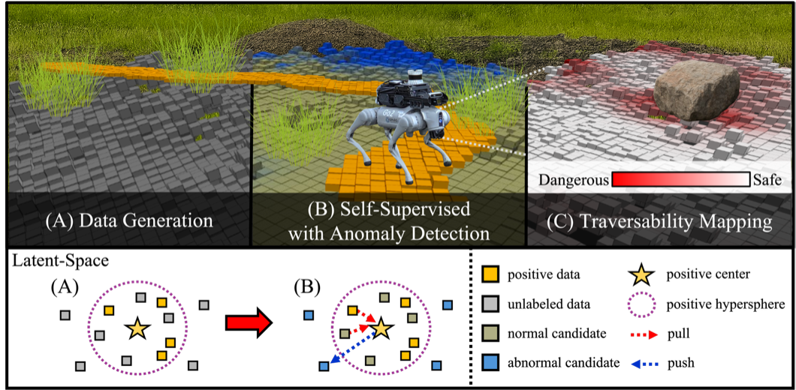
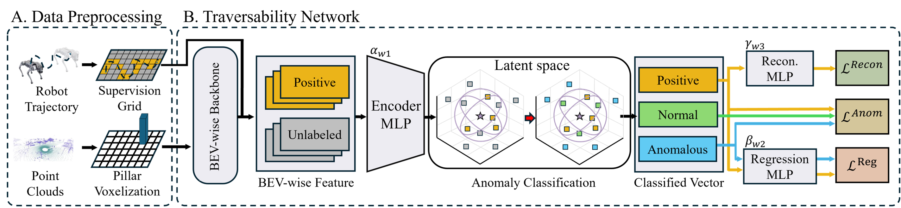

<div align="center">

# GSAT: Geometric Traversability Estimation using Self-supervised Learning with Anomaly Detection for Diverse Terrains

[](https://sparolab.github.io/research/gsat/)
[](https://arxiv.org/abs/2603.07480)
[](https://www.youtube.com/watch?v=1ULi2VL8g1o)
[](#)

**[IEEE ICRA 26] This repository is the official code for GSAT: Geometric Traversability Estimation using Self-supervised Learning with Anomaly Detection for Diverse Terrains.**

**[Dongjin Cho](https://www.linkedin.com/in/dongjineee/), [Miryeong Park](https://www.linkedin.com/in/miiiiiryeong/), [Juhui Lee](https://www.linkedin.com/in/juhui-lee/), [Geonmo Yang](https://www.linkedin.com/in/geonmoyang7422/), [Younggun Cho](https://www.linkedin.com/in/younggun-cho-392799116/)**

[Spatial AI and Robotics Lab (SPARO)](https://sparolab.github.io/), Inha University



</div>

---

## Overview

GSAT learns robot-specific traversability from LiDAR point clouds — without human supervision. It builds a positive hypersphere in latent space using anomaly detection, addressing the positive-only learning problem.

<div align="center">



</div>

---


## Getting Started

### 0. Environment Set up (Docker)

```bash
cd docker

# Build
docker compose -f docker-compose-gui-nvidia.yaml build

# Start container
docker compose -f docker-compose-gui-nvidia.yaml up -d

# Open shell
docker exec -it gsat /bin/bash
```

Inside the container, build the ROS workspace once:

```bash
cd ~/gsat_ws
catkin build
echo "source ~/gsat_ws/devel/setup.bash" >> ~/.bashrc
source ~/.bashrc
```

Build the CUDA voxelization op:

```bash
cd ~/gsat_ws/src/GSAT_Traversability/gsat
python3 setup.py build_ext --inplace
```

---

### 1. Data Collection (ROS)

See [`gsat_ros/README.md`](gsat_ros/README.md) for topic configuration and output format.

```bash
# Terminal 1 — play rosbag
rosbag play <your_bag>.bag

# Terminal 2 — run collection node
roslaunch gsat_ros data_collection.launch
```

Output:

```
collect_data/gazebo/hill/original/
├── supervision.csv          # pose + Travel_label
└── lidar/
    └── <timestamp>.bin      # float32 x, y, z, intensity
```

---

### 2. Preprocess for Train Data

#### Step 1. Train Data Preprocess

Edit `config/data_preprocess.yaml` (set `data_folder` and `output_folder`), then run:

```bash
cd ~/gsat_ws/src/GSAT_Traversability/gsat/data_tools
python3 data_preprocess.py --key {data_name}
```

Output:

```
collect_data/gazebo/hill/process/
├── point/     # Leveled point clouds (*.bin)
└── label/     # Future trajectory + Travel_label (*.bin, K×4)
```

#### Step 2. Dataset Split

Edit `config/data_split.yaml` (set `root_dir`, `preprocess_dir`, `save_dir`, and split ratios), then run:

```bash
python3 data_split.py --key {data_name}
```

Output:

```
collect_data/gazebo/hill/dataset/
├── train/  point/  label/
├── val/    point/  label/
└── test/   point/  label/
```

#### RELLIS-3D

The RELLIS-3D training split and the evaluation ground truth used in the paper are not distributed with this repository. Please contact the authors if you need them.

The RELLIS-3D split (`dataset_pose_r005_arfil0_sampling`) stores one label per robot pose (center line).
Expand the labels to the Warthog footprint before training (points are copied, the input folder is not modified):

```bash
cd ~/gsat_ws/src/GSAT_Traversability/gsat/data_tools
python3 rebuild_footprint_labels.py --key rellis
```

The output folder (`dataset_pose_r005_arfil0_sampling_fp`) is the `dataset_dir` of the `rellis` key in `gsat/config/train.yaml`.

---

### 3. Training

Edit `gsat/config/train.yaml` (set `dataset_dir` and `save_dir`), then run:

```bash
cd ~/gsat_ws/src/GSAT_Traversability/gsat
python3 train.py --key {data_name}
```

Checkpoints are saved as `epoch_*.pth` and `best_model_*.pth` under `save_dir`.

---

### 4. Quantitative Evaluation

`quantitative_eval.py` compares the predicted traversability with semantic ground truth on the BEV grid.

**Ground truth.** A folder of `.ply` files, one per scan, with vertex fields `x, y, z, intensity, label`. Points whose `label` is in `traversable_ids` are traversable. Each BEV cell is
- traversable (1) if all of its points are traversable,
- non-traversable (0) if at least one of its points is not,
- ignored if it has no points.

**Prediction.** The trained model runs on the same scan. A cell is predicted traversable when the distance of its latent vector to the hypersphere center is within the radius saved in the checkpoint (`mean_radius_val`).

**Metrics.** Precision, recall, F1, IoU and AUROC (score = negative distance) are computed per file and averaged over files; these are the numbers reported in the paper. Micro averages over all cells are printed as well.

**Run.** Set `checkpoint_path` and `sem_folder` in `gsat/config/quantitative_eval.yaml` (`point_range` and `voxel_size` must match `train.yaml`), then run:

```bash
cd ~/gsat_ws/src/GSAT_Traversability/gsat
python3 quantitative_eval.py --checkpoint {save_dir}/best_model_XX.pth
```

Use the last `best_model_*.pth` in `save_dir` (highest epoch = lowest validation loss). Set `visualize_bev` or `visualize_3d` to `true` to inspect each file.

---

## Demo

Two demos are available:
- **Anomaly Classification** — inference the anomalous(dissimilar positive samples), normal sample(similar positive sample).
- **Traversability Navigation** — navigate using predicted traversability map.

<div align="center">


*Anomaly classification Demo*


*Traversability-guided navigation Demo*

</div>

> 🚧 **Demo code coming soon...........**

---

## Citation

If you find this work useful, please cite:

```bibtex
@inproceedings{gsat2026,
  title     = {GSAT: Geometric Traversability Estimation using Self-supervised Learning with Anomaly Detection for Diverse Terrains},
  author    = {Cho, Dongjin and Park, Miryeong and Lee, Juhui and Yang, Geonmo and Cho, Younggun},
  booktitle = {IEEE International Conference on Robotics and Automation (ICRA)},
  year      = {2026}
}
```
